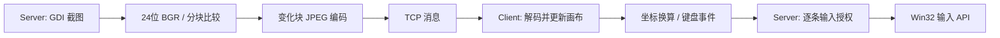

# RemoteControlSystem：Windows 远程桌面教学项目

本项目使用 **C++、MFC、Win32、GDI+ 和 IPv4 TCP**，用于学习桌面采集、图像分块、网络消息、输入事件和多线程协作。Client 是控制端，Server 运行在被观看或控制的电脑上。

原始 VS2008 教程源码已先推送到 [v1.0.0](https://github.com/xuebossvh/RemoteControlSystem-Test/tree/v1.0.0)，对应提交 `40a47b82a703b0c4ee114c878d7d2b8710a93cd4`。基线包含源码、资源、配置样例及中文说明；历史编译缓存、个人 IDE 设置与账户数据留在本地，没有公开上传。

**v1.1.1** 修复输入卡顿、停止移动后末位置丢失、双击多发和拖动越界后松键丢失，并增加同机普通窗口的点击代理。[v1.1.0](https://github.com/xuebossvh/RemoteControlSystem-Test/tree/v1.1.0)修复高 DPI 标签遮挡与客户端最小化恢复后的重绘问题，新增顶部浮动全屏控制条；[v1.0.1](https://github.com/xuebossvh/RemoteControlSystem-Test/tree/v1.0.1)加入 VS2022 / CMake 构建、运行修复、Client 窗口捕获排除与等比显示。原有 13 个章节的详细分析保留在 [v1.0.0 源码详解](./docs/v1.0.0-analysis.md)，其中源码链接固定到原版标签。

## 1. 构建

需要 Windows 10 版本 2004（内部版本 19041）或更新系统、Visual Studio 2022 或 Build Tools 2022、MSVC v143、Windows SDK、匹配的 MFC/ATL，以及 CMake 3.24 或以上。本次使用 **MSVC 14.44.35207 / SDK 10.0.22621.0 / Win32 / Release**。C++ 标准为 C++14，Unicode，静态 MFC 与 `/MT` 运行库。不要切换 x64：协议和二进制数据仍按 Win32 约定。

### 准备 MFC/ATL

已经安装匹配 MFC/ATL 的机器可直接构建。本次环境只有 v143 14.44 编译器，使用以下命令补齐依赖：

```powershell
.\scripts\prepare-mfc.ps1
```

[准备脚本](./scripts/prepare-mfc.ps1)从本机 VS 的官方组件清单取得四个指定微软组件包，校验 SHA-256 后，把头文件与 Win32 Release 库解包到 `.deps/atlmfc`。不修改现有 VS 安装，不需管理员权限，也不会把微软组件提交到 Git；使用仍须遵守其许可。

脚本支持 `-CatalogPath <catalog.json>` 和 `-Destination <目录>`，固定对应 **v143 14.44**。其他版本请通过 Visual Studio Installer 安装匹配的 MFC/ATL，或提供匹配依赖目录。此方案只准备了 Release 库；Debug 需另外安装对应 Debug MFC。

### 编译并执行单元测试

在本 README 所在目录执行：

```powershell
.\scripts\build.ps1
```

[构建脚本](./scripts/build.ps1)配置、编译两个应用及测试，并运行 CTest。也可手动执行：

```powershell
cmake -S . -B build -G "Visual Studio 17 2022" -A Win32
cmake --build build --config Release --parallel
ctest --test-dir build -C Release --output-on-failure
```

非默认依赖位置使用 `-MfcRoot <目录>`，或给 CMake 传入 `-DRCS_ATLMFC_ROOT=<目录>`。现代入口是 [CMakeLists.txt](./CMakeLists.txt)；旧 `.sln/.vcproj` 保留作历史资料，不用于上述构建。

旧程序正在运行时，可使用 `.\scripts\build.ps1 -BuildDirectory build-v1.1.1` 在另一目录构建，避免覆盖被占用的 EXE。测试通过后关闭旧程序，再从新目录启动；如需复用已有账户，可用下面的 `--data-dir` 指向原数据目录。

```text
build/bin/Release/
├── Server.exe
├── Client.exe
├── Server-data/
│   └── RemoteConfig.ini
└── Client-data/
    └── ClientConfig.xml
```

应用静态链接 MFC 与 C/C++ 运行库，图像处理使用 Windows 自带 GDI+，不需要原版 CxImage/JPEG/PNG 等额外 DLL。构建仅在配置不存在时复制样例，不覆盖已有配置或账户。

## 2. 首次运行

1. 启动 `build/bin/Release/Server.exe`。本地管理界面密码来自 [配置样例](./config/RemoteConfig.ini)，初值为 **111**，进入后应修改为自己的密码。
2. 在“账号管理”新建远程账户，选择观看或控制权限。用户名、密码使用 **1～19 个 ASCII 字符**。本地管理密码和远程账户是两套凭据；没有预置远程账户。
3. 确认端口并点击“启动服务”。样例为 **TCP 8900**。Server 是桌面程序，该按钮启动 TCP 监听，不是安装 Windows Service。
4. 启动 `build/bin/Release/Client.exe`，选择 Local，输入新建的远程账户。同机实验使用 `127.0.0.1:8900`；两机实验添加被控电脑的 IPv4 地址与端口。
5. 登录后观看画面；控制账户可以发送基本键鼠操作。工具栏提供适应窗口、缩放、全屏、截图和图像参数设置。
6. 用 Server 连接列表断开会话，或停止服务。关闭时先断开连接，再等待工作线程结束并释放对象。

### 顶部全屏控制条

登录后，远程画面顶部居中显示当前权限以及“全屏 / 适应窗口 / 断开”控制条：

- 点击“全屏”，主窗口切换为覆盖当前显示器完整区域的无边框窗口，本机任务栏被窗口覆盖。这里显示的仍是 Server 桌面；Server 自己的任务栏属于远程画面，会正常显示。
- 全屏时，鼠标离开控制条约 1.8 秒后，控制条收起为顶部细条；把鼠标移到屏幕顶端中间即可展开。
- 点击“退出全屏”或按 `Esc` 返回原来的窗口位置和最大化状态；`Ctrl+Shift+Enter` 也可以切换全屏。
- “适应窗口”恢复等比显示完整桌面；“断开”结束当前会话并关闭 Client。
- 权限标签为“可控制”或“同机控制”时才允许控制操作；如果显示“仅观看”，请使用 Server 上具有控制权限的账户重新登录。更改账户权限后，应断开旧连接再登录。

全屏只调整 Client 自己的窗口，不关闭、隐藏或修改系统任务栏设置。显示区和控制条都是 Client 主窗口的子窗口，最小化时一起隐藏；恢复时直接从缓存重绘，即使暂时没有新网络图像也可以恢复画面。操作控制条、登录框或设置框不会被当作远端鼠标/键盘事件发送。

### 鼠标操作：两台电脑与同机实验

**两台电脑连接**：将鼠标移进远程画面即可控制，移出后正常操作本机窗口，不锁定、不隐藏本机光标。只有按住鼠标拖动时捕获输入；即使移出画面再松开，也会发送松键。失去焦点、最小化、切换全屏或断开连接会释放记录的按键。Server 使用带标记的 `SendInput`，Client 不会回传这些标记事件；鼠标坐标按同一绘制矩形换算为远端物理像素。

移动事件不再由 UI 每秒 24 次直接丢弃。独立发送线程合并连续移动，约每 8 ms 发送最新位置；停止移动后的最后一点仍会发送。点击、松键、键盘和设置消息保持顺序，启用 `TCP_NODELAY`，避免网络等待卡住界面。双击只保留两次按下/松开，不再把第二次按下重复展开为一整组双击。鼠标滚轮及中键也使用原有 13 字节包传输。

**Client、Server 在同一台电脑同一桌面**：只有一个系统光标，不能通过两次 `SendInput` 得到两个独立鼠标。旧版把画布中的点再次映射到桌面后，会拉走用户的真实光标；Client 虽不出现在截图中，仍遮住真实点击目标，因此看得到文件却点不到。

v1.1.1 在登录后核对 TCP 连接所属进程、Windows 会话和桌面，确认双方确实共用桌面才显示“同机控制”。该模式保留本地光标位置，按画面坐标查找 Client 后方的普通控件，通过控件操作处理选择、点击和打开文件，不把输入再次送往 Server 移动系统光标；同机使用本机局域网 IP 也能识别，单凭 `127.0.0.1` 不会误判。旧 Server 不提供这个协商，建议两端一起更新。

资源管理器的辅助功能接口在选择文件时可能把自身带到前面，原本会打断 Client 中的第二次点击。本机选择操作现在仅在前景转到本次目标窗口时恢复 Client 的画布焦点和捕获；打开文件后不强行抢回新应用的前景。被取消的操作不会在接口返回后重新变成按下状态，点击不支持的控件后也不会继续把键盘输入发送给之前的输入框。

同机代理是教学演示能力：标准按钮、列表和支持辅助功能接口的文件项可以操作；游戏、Raw Input/DirectInput、自绘控件、提权窗口、系统安全桌面及任意窗口的原生拖放不能保证。遇到不支持的点击，标题栏会提示，不会退回移动共享光标的方式。完整桌面控制请把 Server 放在另一台电脑或具有独立桌面的虚拟机里。

例如，两端更新并使用控制账户登录后，顶部应显示“同机控制”；在远程画面内单击普通文件列表的文件进行选择，双击打开。随后直接把鼠标移出 Client，便可继续操作本地窗口，不必按退出热键。如果顶部显示“仅观看”，点击不会执行。

**同机观看不再采集 Client 自身。** 在支持的系统上，Client 的主窗口、登录框、显示窗口、设置及其他顶层弹窗在本机仍然可见；Server 继续采集整个主屏幕，但画面中呈现的是这些窗口后方的桌面内容，避免重复“套娃”。两机使用时只需配置所选端口的必要防火墙规则。

该功能由 [CaptureExclusion](./RemoteCtrolSystem/Client/CaptureExclusion.cpp)在 Client 自己的 UI 线程中，为顶层窗口设置 `WDA_EXCLUDEFROMCAPTURE`，不修改其他程序的窗口。Windows 10 2004 起支持这一标志，且需要 DWM 桌面合成；条件不满足或调用失败会明确提示，不会静默当作成功。机制和限制见[微软 API 文档](https://learn.microsoft.com/en-us/windows/win32/api/winuser/nf-winuser-setwindowdisplayaffinity)。这一设置也会影响遵守该机制的其他截图/录屏工具对 Client 窗口的采集。

因此，“肉眼看到的远程画面黑了”和“系统截图/录屏没有捕获到 Client”需要区分。后者可能是防套娃机制的正常效果；需要保存远程画面时，可使用 Client 自身的截图按钮。

仅用于自己的设备或获得明确授权的实验环境。**当前协议没有 TLS，账户字段仍以原始字节传输，不适合直接作为公网管理服务。**

### 数据目录

默认使用 EXE 旁的 Server-data / Client-data，不再依赖终端或快捷方式原来的工作目录。可以显式隔离测试数据：

```powershell
.\build\bin\Release\Server.exe --data-dir C:\Temp\RcsServerTest
.\build\bin\Release\Client.exe --data-dir C:\Temp\RcsClientTest
```

指定目录的父目录须存在，且当前用户有写权限。程序会创建末级目录；缺少 INI/XML 时生成初始配置，已有但损坏的 XML 会报错，不会静默覆盖。

| 文件 | 用途 |
| --- | --- |
| `Server-data/RemoteConfig.ini` | 本地密码、端口和界面选项 |
| `Server-data/user.dpapi` | 默认账户文件，由当前 Windows 用户的 DPAPI 保护 |
| `Server-data/user.plain` | 关闭加密时的二进制账户数据，不是文本 |
| `Server-data/IpRule.dat` | IP 范围规则，第一条匹配生效，未匹配默认允许 |
| `Client-data/ClientConfig.xml` | 主机名称、IPv4 地址、端口 |

DPAPI 保护本地文件，**不保护网络传输，也不是密码哈希**。文件不能直接复制给另一个 Windows 用户使用。原版 user.crypt 的密钥长度存在缺陷，本版本不自动转换、覆盖或删除它；请通过界面重新创建实验账户并保留原数据副本。

## 3. 实现原理



### 图像链路

[ScreenShot](./RemoteCtrolSystem/Graphic/ScreenShot.cpp)使用 GDI BitBlt 截图，统一为 **24 位 BGR、从上到下的像素行、4 字节对齐行步长**。每一块与上一轮原始像素比较：首屏发送全部块，之后只编码和传输变化块。

[GdiImage](./RemoteCtrolSystem/Graphic/GdiImage.cpp)负责编解码、像素转换、深拷贝和绘制；内部支持 BMP/JPEG/PNG/GIF/TIFF，截图菜单提供 BMP/JPEG/PNG。[ScreenDisplay](./RemoteCtrolSystem/Graphic/ScreenDisplay.cpp)按矩形位置更新持久画布，检查长度、边界及解码尺寸。

显示采用 `min(显示区宽/桌面宽, 显示区高/桌面高)` 计算统一缩放比例，居中显示，剩余区域留黑边。窗口缩放、远端尺寸变化和工具栏缩放均从原始桌面比例重新计算，避免文字越来越宽。绘制与鼠标换算共用同一矩形；黑边及视口外的鼠标位置不会发送到 Server。

两端在创建窗口前启用进程级系统 DPI 感知，使桌面尺寸、GDI 截图和鼠标坐标使用物理像素，不改变用户的显示缩放设置。修复前在本机 200% 缩放环境中，2560×1600 的主屏幕曾只采到物理左上角 1280×800；该场景已加入整屏像素回归验证。混合 DPI 的多显示器切换仍不属于已验证范围。

服务端初值为 **15×15 分块、采集设置 10、质量 60**；客户端初始设置现在实际发送，界面初始质量 **100** 会应用到服务端。修改画质、网格或尺寸会刷新必要的图像块。采集结束后才休眠，设置值不保证实际 FPS。

这是变化块传输，没有视频编码的运动估计，也没有完整帧序号/帧结束消息。静态桌面开销低，大范围动画会增加 CPU、带宽和延迟。

### 协议与线程

握手依次为：**TCP 连接 → IP 许可 → 账户验证 → 返回权限 → 屏幕尺寸与同机识别信息 → 图像流**。账户响应：-1 为错误凭据、0 为观看、1 为控制、2 为账户已登录。登记账户使用原子检查；服务端逐条复核收到的键鼠控制权限，同机代理也要求当前连接具有控制权限。

[TCPConnection](./RemoteCtrolSystem/SocketIPv4/TCPConnection.cpp)为每个连接保留独立接收缓存，处理分片和粘包；完整发送循环处理短写。客户端队列有内存和消息数限制，通过背压避免无限增长。

| 类型 | 字段 | 长度（字节） |
| --- | --- | --- |
| 1：图像 | 类型 + RECT 四个 int32 + uint32 JPEG 长度 + 数据 | 21 + N |
| 2：鼠标 | 类型 + X + Y + 状态 | 13 |
| 3：键盘 | 类型 + 虚拟键 + 状态 | 9 |
| 4：登录 | 类型 + 20 字节用户名 + 20 字节密码 | 41 |
| 5：设置 | 类型 + 设置类别 + value1 + value2 | 13 |

整数沿用 Win32 小端表示，单块 JPEG 上限 16 MiB，账户字段验证终止符。完整设置常量及原协议背景见[历史协议说明](./docs/v1.0.0-analysis.md#protocol)。

v1.1.1 增加设置类别 `0x5700`，值为 Server 的进程 ID、处理连接的线程 ID，用于与本机操作系统的 TCP 表、会话和桌面信息交叉验证；这些数值本身不是身份证明。滚轮包的状态低 16 位为 `WM_MOUSEWHEEL` / `WM_MOUSEHWHEEL`，高 16 位为有符号滚动量，包长不变。客户端发送队列最多 512 条，只合并相邻移动；严重背压导致关键事件无法入队时会断开连接，避免静默丢弃松键。Server 在连接结束时释放该连接记录的按键。

Server 使用监听线程、每连接处理线程、图像发送线程；Client 网络线程生产消息，UI 定时消费并使画布失效，由 [RemoteCanvas](./RemoteCtrolSystem/Client/RemoteCanvas.cpp)的 `WM_PAINT` 调用同一缓存绘制路径。UI 每轮处理使用约 8 ms 的时间预算，完成当前消息后让出循环，避免整屏更新时连续解码数百个 JPEG 块阻塞点击；单个图像的解码仍不可中途打断。最小化不把画布缩为零尺寸，恢复、调整窗口或解除遮挡时都可以重绘原有图像。关闭时先停止 Socket I/O，再等待线程，最后释放句柄和队列。连接列表使用异步窗口消息刷新，避免工作线程同步等待被阻塞的 UI。

Server 每 5 秒发送一次完整图像块更新，用于恢复未变化但曾被拒收的块。截图暂时失败时保留连接并稍后重试，恢复后强制完整更新；合法的全黑桌面仍被当作正常图像，不通过“是不是黑色”猜测故障。

## 4. 已修复内容与边界

| 相对 v1.0.0 的改动 | 目的 |
| --- | --- |
| CMake、依赖准备及构建脚本 | 用 VS2022 复现编译 |
| 活跃 C++ 源码 UTF-8，资源 UTF-8 BOM | 修复中文资源编译失败 |
| GDI+ 替换活动的 CxImage 调用 | 移除缺失依赖，修复像素格式与行步长 |
| 完整 TCP 收发、长度限制、独立缓存 | 处理分片、粘包、短写与断开 |
| 服务端逐条授权 | 修复只靠客户端限制观看权限的问题 |
| 明确数据目录、XML 检查、DPAPI | 修复路径依赖、空指针及旧加密问题 |
| 显示控件大小、坐标映射、初始参数、截图保存 | 连通实际 UI 与图像链路 |
| 线程回收、队列引用清理 | 修复停止/关闭时的对象生命周期 |
| 停用原自动监控入口 | 缺失 DLL 不再导致控制账户登录崩溃 |
| Client 顶层窗口捕获排除 | 同机仍显示整个桌面，但不把 Client 自身传回 |
| 等比显示与统一输入映射 | 消除横纵拉伸，正确处理黑边、缩放和坐标 |
| 进程级 DPI 感知 | 避免高 DPI 下只截取主屏幕左上区域 |
| Server 标签页按原生内容区布局 | 适配实际字体/DPI，页面不再遮住 tab 文字 |
| 嵌入式画布和持久缓存重绘 | 修复最小化恢复及遮挡后画面丢失 |
| 顶部全屏控制条 | 覆盖本机任务栏，支持自动收起、Esc 退出和窗口状态恢复 |
| 周期完整更新及截图失败重试 | 避免一次失败后静态区域长期无法恢复 |
| 输入注入标记及 Client 回注过滤 | 修复同机鼠标/键盘反馈循环，并保留每条输入的权限检查 |
| 独立输入发送线程、移动合并、TCP_NODELAY | 避免 UI 阻塞并保留停止时的最后位置 |
| 双击序列与拖动释放修复 | 避免额外点击及松开按钮后仍处于拖动状态 |
| 同机识别与控件点击代理 | 不拉走共享光标，普通文件点击可命中 Client 后方目标 |

当前限制：

- 原版应用/文件活动自动监控 **未启用**；保留代码与日志查看入口，当前不会自动监控 D、E 盘。
- 多显示器、跨 DPI、UAC 安全桌面、音频、剪贴板、文件传输、录像不属于本轮已验证能力。同机代理的右键菜单、中键操作及文件拖放暂不模拟；异机路径支持左右中键和两轴滚轮。
- 缩放画面在可见区域等比居中绘制；放大超出视口时裁剪，原滚动逻辑仍停用。调整窗口大小保留相对缩放倍率，“适应窗口”恢复完整桌面。
- 未加入 TLS、心跳、自动重连；长期运行、大量并发及各种异常网络仍需进一步验证。
- 部分历史界面选项、主机列表管理仍沿用旧实现，不应推定所有菜单完整可用。

## 5. 源码阅读顺序

| 顺序 | 入口 | 重点 |
| --- | --- | --- |
| 1 | [CMake](./CMakeLists.txt)、[Client](./RemoteCtrolSystem/Client/Client.cpp)、[Server](./RemoteCtrolSystem/RemoteCtrolSystemServer/RemoteCtrolSystemServer.cpp) | 模块和进程入口 |
| 2 | [ByteArrayMsg](./RemoteCtrolSystem/Message/ByteArrayMsg.cpp)、[SetupMsg](./RemoteCtrolSystem/Message/SetupMsg.cpp) | 消息布局与校验 |
| 3 | [TCPClient](./RemoteCtrolSystem/SocketIPv4/TCPClient.cpp)、[DealConnection](./RemoteCtrolSystem/RemoteCtrolSystemServer/DealConnection.cpp) | 握手和权限 |
| 4 | [ScreenShot](./RemoteCtrolSystem/Graphic/ScreenShot.cpp)、[GdiImage](./RemoteCtrolSystem/Graphic/GdiImage.cpp)、[ScreenDisplay](./RemoteCtrolSystem/Graphic/ScreenDisplay.cpp) | 图像流水线 |
| 5 | [ClientMain](./RemoteCtrolSystem/Client/ClientMain.cpp)、[MouseKeybdEvent](./RemoteCtrolSystem/RemoteCtrolSystemServer/MouseKeybdEvent.cpp)、[LocalPeer](./RemoteCtrolSystem/Client/LocalPeer.h)、[LocalDesktopInput](./RemoteCtrolSystem/Common/LocalDesktopInput.cpp) | 输入回传、坐标、同机识别与控件操作 |
| 6 | [TCPThreadedServer](./RemoteCtrolSystem/SocketIPv4/TCPThreadedServer.cpp)、[TabConnectionDlg](./RemoteCtrolSystem/RemoteCtrolSystemServer/TabConnectionDlg.cpp) | 生命周期和 UI 协作 |
| 7 | [HostListConfig](./RemoteCtrolSystem/ClientConfig/HostListConfig.cpp)、[UserFile](./RemoteCtrolSystem/RemoteCtrolSystemServer/UserFile.cpp) | 配置和持久化 |

旧 [CxImage](./RemoteCtrolSystem/CxImage/) 和 [cppsocket_source](./cppsocket_source/)保留供对照，不参与现代构建。更完整的原版目录、参数、API 和问题分析见[历史详解](./docs/v1.0.0-analysis.md)。

## 6. 验证与排错

本机 Release 构建的八组 CTest 均已通过：

- [图像测试](./RemoteCtrolSystem/Graphic/tests/image_tests.cpp)：人工像素、奇数宽度、行步长、上下方向、PNG/JPEG、合成、坏数据。
- [协议测试](./tests/protocol_tests.cpp)：分片/合并、头部边界、长度限制、回环传输、握手余包、主动断开、服务回收。
- [账户测试](./tests/account_tests.cpp)：DPAPI、错误密码、重复账户、权限修改、格式切换、保留旧密文。
- [显示几何测试](./RemoteCtrolSystem/Graphic/tests/display_geometry_tests.cpp)：等比缩放、横竖视口、黑边拒绝、角落/中心坐标、分辨率变化和反复缩放不漂移。
- [显示恢复测试](./RemoteCtrolSystem/Graphic/tests/display_recovery_tests.cpp)：无新包时缓存重绘、零尺寸/恢复、资源释放、坏 JPEG 不覆盖有效画面、静态丢块恢复和合法黑色图像。
- [输入结构测试](./tests/remote_input_tests.cpp)：物理坐标边界、单调归一化、输入标记与键盘扩展键释放标志；此测试不注入真实输入。
- [同机控件测试](./tests/local_input_tests.cpp)：用自建窗口固定延迟 20 ms 响应命中检查，验证旧 10 ms 等待会丢失点击而 50 ms 可处理；检查列表选择、一次双击通知及取消后不执行。只短暂创建自己的小窗口，不移动光标、不注入物理输入。
- [异步输入队列测试](./RemoteCtrolSystem/SocketIPv4/tests/client_send_tests.cpp)：连续 2,000 次移动的末位置、按钮/键盘/设置的顺序、实际 `TCP_NODELAY`、慢接收端背压、并发发送/关闭及重连后无旧包泄漏。

常规回环冒烟覆盖认证、JPEG 数据、观看权限限制、IP 拒绝、重连、主窗口显示、绘制区域和正常关闭。全局键盘输入未注入；没有完成两台电脑联调或长期压力测试。MFC 对话框式应用正常关闭时可能返回对话框结果码（Client 为 2、Server 为 1），测试同时检查退出过程和超时，而非只要求返回 0。

真实窗口与回环测试需在交互式 Windows 桌面上手动执行，使用 Python 3.10 或以上：

```powershell
python tests/runtime_smoke.py --bin-dir build/bin/Release --report build/runtime-smoke.json
```

[冒烟脚本](./tests/runtime_smoke.py)只操作自己启动的程序，使用独立临时配置、账户和空闲端口。它检查登录、图像包、凭据、权限、IP 规则、重连与窗口关闭，不保存或上传截图，不发送全局键盘输入。测试结果以脚本报告为准，不代表已经完成异机、多显示器 DPI 切换或长期压力测试。

另有[捕获排除回归](./tests/capture_exclusion_smoke.py)，需要 Pillow，在内存中解码 Server 实际传来的 JPEG：

```powershell
python tests/capture_exclusion_smoke.py --bin-dir build/bin/Release --report build/capture-exclusion-smoke.json
```

此测试会短暂显示覆盖主屏幕的合成色块背景，只操作自己启动的程序。它先验证未排除的遮挡窗口确实会被采集，再逐项检查 Client 登录框、主窗口、显示弹窗和设置窗口所在区域恢复为实时变化的背景，而非黑块、旧画面或客户端自身。图像不落盘、不上传；报告只记录尺寸和颜色误差等测量值。

窗口启用捕获排除后，Windows 也可能拒绝外部进程对 Client 窗口执行 `GetPixel`。常规冒烟测试只有在确认排除标志为 `0x11`，且所有采样都返回 `CLR_INVALID` 时，才将这项跨进程读取记录为跳过；窗口可见性和布局仍单独检查，Server 实际 JPEG 中的排除效果由上述色块回归验证。

v1.0.1 的实际结果：捕获排除回归 **8 项通过**，常规冒烟 **13 项通过、2 项明确跳过**（全局键盘注入及受 WDA 限制的外部像素读取）。本机 200% 缩放环境下，协议图像与物理主屏幕均为 2560×1600；Client 各窗口所在区域的背景采样全部匹配，JPEG 的最大 RGB 误差为 3，没有黑块或自我嵌套。

v1.1.0 另有[窗口模式回归](./tests/ui_modes_smoke.py)：

```powershell
python tests/ui_modes_smoke.py --bin-dir build/bin/Release --report build/ui-modes-smoke.json
```

它检查四个标签页的实际布局，并让测试 Client 只接收一张人工棋盘 JPEG，随后不再发图，以验证最小化/恢复、遮挡、全屏切换确实依靠缓存恢复。测试通过显式 `--ui-paint-self-test` 启用同进程离屏采样，再结合真实 `WM_PAINT` 成功计数验证绘制；普通启动不启用此诊断接口。整个测试不取消捕获排除，不跨进程传递 GDI 句柄，不保存真实桌面截图，也不操作其他已运行的 Client/Server。

实际结果：窗口模式回归 **20 项通过，无跳过**。只发送一张 JPEG 后，11 次缓存检查的每次 112 个采样点均无黑点、无错误；覆盖三轮最小化恢复、遮挡重绘及“最大化 → 全屏 → 最小化恢复 → 返回最大化”。200% DPI 下四个标签页无遮挡；全屏覆盖 2560×1600 的完整显示器，浮条可以收起和展开。常规冒烟 14 项通过、2 项预定跳过，捕获排除回归 8 项通过。

鼠标还有两组显式交互测试（执行时会短暂移动光标，结束后恢复）：

```powershell
python tests/remote_input_smoke.py --bin-dir build/bin/Release --report build/remote-input-smoke.json
python tests/client_input_smoke.py --bin-dir build/bin/Release --report build/client-input-smoke.json
```

[Server 输入测试](./tests/remote_input_smoke.py)使用新启动的隔离 Server 与专用空白目标窗口，验证观看账户不能移动光标、控制账户请求的物理位置实际到达并带有注入标记。v1.1.1 的 8 项实测还包括左右双击各两组按下/松开、中键、两轴滚轮正负增量，以及按下后断连由 Server 释放。点击仅送入测试自己的目标，滚轮前确认目标是本次测试的前景窗口；不注入键盘。

[Client 输入测试](./tests/client_input_smoke.py)只连接人工画面的模拟服务，验证普通移动发送正确坐标、带标记移动零回发、之后普通输入仍正常，以及只点击自身工具条不会产生远端输入。两组实际测试均通过，测试进程和临时数据已清理，原光标已恢复。

v1.1.1 的 Client 输入回归已扩充为 10 项，包含快速移动的最后一点、双击恰好两组按下/松开、拖动越出画布后释放、两轴滚轮的有符号增量、中键和伪造本机身份被拒绝。模拟 Server 只收包，不向其他程序注入操作。

新增[同机端到端回归](./tests/local_control_smoke.py)同时启动真实 Client、Server 和专用原生文件列表窗口，所有配置、文件和端口都隔离。9 项实测通过：从 Client 画面内驱动物理鼠标，共享光标不跳转；控件选择生效；一次双击只读取并显示一次本次创建的测试文件；越界松键和最小化恢复后继续操作成功；观看账户不能打开文件。该测试覆盖的是普通原生列表，不应据此推定所有程序的自绘控件都能被后台操作。

```powershell
python tests/local_control_smoke.py --bin-dir build/bin/Release --allow-input --report build/local-control-smoke.json
```

[真实资源管理器回归](./tests/explorer_local_control_smoke.py)的 3 项实测也通过：只在新建的专用文件夹窗口中，单击不会执行文件；经真实 Client 画面双击后，唯一的测试文件实际打开一次，光标位置保持不变。测试文件是本次创建的无害 `.cmd`，仅向同目录写入一行执行标记并退出，不读取用户文件、不改变文件关联。测试按窗口句柄和精确目录核对身份，只关闭自己新开的资源管理器窗口，不终止 Explorer 进程；临时文件及自有进程已清理。

```powershell
python tests/explorer_local_control_smoke.py --bin-dir build/bin/Release --allow-input --report build/explorer-local-control-smoke.json
```

v1.1.1 同时复测常规冒烟（14 通过、2 项明确跳过）、窗口模式（20 通过）与捕获排除（8 通过）。以上是本机与回环环境的结果，尚未完成两台实体电脑联调。

| 问题 | 检查方式 |
| --- | --- |
| 缺 afxwin.h / uafxcw.lib | 确认 MFC/ATL 与工具集匹配，运行准备脚本或指定 MfcRoot |
| Debug 链接失败 | 本次准备的是 Release 库，Debug 需另装对应组件 |
| 找不到 CxImage 库 | 改用现代 CMake 入口，不构建旧 .sln |
| Client 提示 XML 损坏 | 检查实际数据目录中的文件，先保留副本再修正 |
| Server 无法监听 | 检查端口范围、占用和系统网络错误 |
| 登录失败 | 区分两套密码，检查重复登录和 IP 规则 |
| 复制账户后不能读取 | DPAPI 绑定 Windows 用户，可通过界面重建测试账户 |
| 没有操作日志 | 缺失的监控组件在本轮未启用 |

## 7. 许可证

根目录 [LICENSE](./LICENSE)为 GPL 第 3 版文本。保留的 CxImage、TinyXML 和 Socket 参考源码带有各自许可说明，使用与再分发时需分别遵守。微软 MFC/ATL 只作为本地构建依赖下载，不上传到源码仓库。
