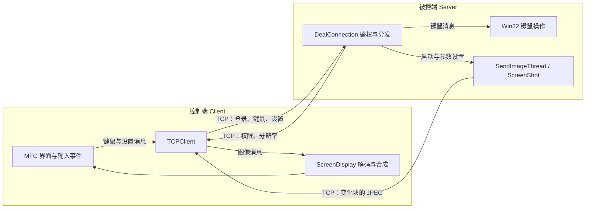

> Historical analysis of the original v1.0.0 source. Links point to the frozen tag; current build instructions are in [README](../README.md). Persisted account files were excluded from the public snapshot.

# RemoteControlSystem：Windows 远程桌面控制与监视学习项目

这是一个使用 **C++、MFC、Win32 API 和 Winsock TCP** 编写的远程桌面项目。控制端连接被控电脑后，可以接收桌面画面，并根据账户权限发送键盘、鼠标操作；被控端还包含账户管理、IP 访问规则、连接管理和本地操作记录功能。

它适合学习“桌面采集 → 图像压缩 → 网络传输 → 客户端显示 → 输入事件回传”这一完整链路，以及多线程、二进制协议和 Windows GUI 程序之间的协作。

**当前代码是一份旧版教学工程。** 主解决方案为 Visual Studio 2008 / Win32，部分外部依赖缺失，部分界面选项尚未完整接入业务逻辑。下文依据当前源码解释实现，不代表已经在现代 Windows / Visual Studio 上完成编译和联机验证。

## 阅读导航

- [1. 两端角色与功能范围](#roles)
- [2. 目录与模块职责](#modules)
- [3. 一次连接如何建立](#connection)
- [4. 桌面画面如何传输](#graphics)
- [5. 鼠标和键盘如何回传](#input)
- [6. 自定义 TCP 消息协议](#protocol)
- [7. 构建环境与依赖](#build)
- [8. 运行与配置](#run)
- [9. 操作记录的实现边界](#monitor)
- [10. 推荐源码阅读顺序](#reading)
- [11. 已知问题与排查](#limitations)
- [12. 可继续完成的练习](#roadmap)
- [13. 验证说明与许可证](#verification)

<a id="roles"></a>
## 1. 两端角色与功能范围

这里的 Client / Server 按 **TCP 连接角色** 命名：

| 程序 | 运行位置 | 职责 |
| --- | --- | --- |
| Client（控制端） | 操作者的电脑 | 主动连接 Server，显示远程画面，发送输入和显示参数 |
| Server（被控端） | 被观看或控制的电脑 | 监听连接，验证账户，采集本机桌面，执行客户端发来的键鼠操作 |

Server 是带有 MFC 窗口的桌面程序；界面中的“启动服务”指启动 TCP 监听，并不意味着它是 Windows Service。两端直接建立 IPv4 TCP 连接，当前实现没有中继服务器、NAT 穿透或浏览器客户端。

| 能力 | 当前源码中的实现情况 |
| --- | --- |
| 远程观看 | 被控端截图、分块比较、JPEG 编码，控制端解码并合成画面 |
| 远程控制 | 有键盘按下/释放、鼠标移动、左右键等处理路径；中键与滚轮未完整实现 |
| 显示调整 | 有缩放、适应本地大小、全屏和本地保存截图的代码 |
| 图像参数 | 有画质、采集频率和横纵分块设置；初始化参数发送存在遗漏，见后文 |
| 用户管理 | 可管理远程账户及观看/控制权限，登录时校验用户名与密码 |
| IP 规则 | 按 IP 范围允许或禁止连接，支持调整规则优先顺序 |
| 连接管理 | 显示连接信息、断开连接、调整连接权限 |
| 操作记录 | 包含文件系统变更记录；应用程序活动监控依赖缺失的外部 DLL |
| 主机列表 | XML 保存主机名称、IPv4 地址和端口；删除持久化逻辑未完成 |
| 文件传输、剪贴板、音频、录像回放 | 当前主协议和业务流程中没有这些功能 |

本项目可用于本人设备或获得明确授权的实验环境。现有协议没有 TLS，账号密码会以原始字段传输；不宜直接作为公网远程管理服务使用。

<a id="modules"></a>
## 2. 目录与模块职责

主工程位于 [RemoteCtrolSystem/](https://github.com/xuebossvh/RemoteControlSystem-Test/tree/v1.0.0/RemoteCtrolSystem/)，名称中的 `Ctrol` 是原目录拼写，引用路径时应保留。

```text
RemoteControlSystem-master/
├── README.md
├── LICENSE
├── RemoteCtrolSystem/
│   ├── RemoteCtrolSystem.sln       # VS2008 解决方案
│   ├── Client/                    # 控制端 MFC 应用
│   ├── RemoteCtrolSystemServer/    # 被控端 MFC 应用（项目名 Server）
│   ├── Graphic/                   # 截图、分块、差分比较、显示
│   ├── Message/                   # 消息类型与字节序列封装
│   ├── SocketIPv4/                # IPv4 Socket、连接和监听线程
│   ├── Thread/                    # 线程、互斥锁、自动加解锁
│   ├── ClientConfig/              # 客户端 XML 主机列表
│   ├── tinyxml/                   # XML 解析源码
│   └── CxImage/                   # 图像处理源码及相关文件
└── cppsocket_source/              # 独立 Socket 参考源码，未加入主解决方案
```

[解决方案](https://github.com/xuebossvh/RemoteControlSystem-Test/blob/v1.0.0/RemoteCtrolSystem/RemoteCtrolSystem.sln)包含 8 个项目：Client、Server、Graphic、Message、SocketIPv4、Thread、tinyxml、ClientConfig。CxImage 不在这 8 个项目中；项目通过额外的库文件引用它。

| 模块 | 关键源码 | 适合观察的内容 |
| --- | --- | --- |
| 控制端 | [Client.cpp](https://github.com/xuebossvh/RemoteControlSystem-Test/blob/v1.0.0/RemoteCtrolSystem/Client/Client.cpp)、[ClientMain.cpp](https://github.com/xuebossvh/RemoteControlSystem-Test/blob/v1.0.0/RemoteCtrolSystem/Client/ClientMain.cpp) | MFC 应用入口、登录、消息循环、远程画面和工具栏 |
| 被控端 | [RemoteCtrolSystemServerDlg.cpp](https://github.com/xuebossvh/RemoteControlSystem-Test/blob/v1.0.0/RemoteCtrolSystem/RemoteCtrolSystemServer/RemoteCtrolSystemServerDlg.cpp)、[DealConnection.cpp](https://github.com/xuebossvh/RemoteControlSystem-Test/blob/v1.0.0/RemoteCtrolSystem/RemoteCtrolSystemServer/DealConnection.cpp) | 启停监听、每条连接的鉴权和命令处理 |
| 图形 | [ScreenShot.cpp](https://github.com/xuebossvh/RemoteControlSystem-Test/blob/v1.0.0/RemoteCtrolSystem/Graphic/ScreenShot.cpp)、[ImageTile.cpp](https://github.com/xuebossvh/RemoteControlSystem-Test/blob/v1.0.0/RemoteCtrolSystem/Graphic/ImageTile.cpp)、[ScreenDisplay.cpp](https://github.com/xuebossvh/RemoteControlSystem-Test/blob/v1.0.0/RemoteCtrolSystem/Graphic/ScreenDisplay.cpp) | GDI 截图、块比较、JPEG 编解码、局部画面更新 |
| 协议 | [MessageData.h](https://github.com/xuebossvh/RemoteControlSystem-Test/blob/v1.0.0/RemoteCtrolSystem/Message/MessageData.h)、[ByteArrayMsg.cpp](https://github.com/xuebossvh/RemoteControlSystem-Test/blob/v1.0.0/RemoteCtrolSystem/Message/ByteArrayMsg.cpp) | 消息类型、长度判断、字节缓存 |
| 网络 | [TCPClient.cpp](https://github.com/xuebossvh/RemoteControlSystem-Test/blob/v1.0.0/RemoteCtrolSystem/SocketIPv4/TCPClient.cpp)、[TCPThreadedServer.cpp](https://github.com/xuebossvh/RemoteControlSystem-Test/blob/v1.0.0/RemoteCtrolSystem/SocketIPv4/TCPThreadedServer.cpp)、[TCPConnection.cpp](https://github.com/xuebossvh/RemoteControlSystem-Test/blob/v1.0.0/RemoteCtrolSystem/SocketIPv4/TCPConnection.cpp) | 连接、监听、线程服务工厂、收发和拆包 |
| 并发 | [Thread.h](https://github.com/xuebossvh/RemoteControlSystem-Test/blob/v1.0.0/RemoteCtrolSystem/Thread/Thread.h)、[AutoLock.cpp](https://github.com/xuebossvh/RemoteControlSystem-Test/blob/v1.0.0/RemoteCtrolSystem/Thread/AutoLock.cpp) | 线程启动/结束、互斥、作用域加锁 |
| 客户端配置 | [HostListConfig.cpp](https://github.com/xuebossvh/RemoteControlSystem-Test/blob/v1.0.0/RemoteCtrolSystem/ClientConfig/HostListConfig.cpp) | 用 TinyXML 读取和保存主机列表 |
| 服务端持久化 | [Config.cpp](https://github.com/xuebossvh/RemoteControlSystem-Test/blob/v1.0.0/RemoteCtrolSystem/RemoteCtrolSystemServer/Config.cpp)、[UserFile.cpp](https://github.com/xuebossvh/RemoteControlSystem-Test/blob/v1.0.0/RemoteCtrolSystem/RemoteCtrolSystemServer/UserFile.cpp)、[IpRuleFile.cpp](https://github.com/xuebossvh/RemoteControlSystem-Test/blob/v1.0.0/RemoteCtrolSystem/RemoteCtrolSystemServer/IpRuleFile.cpp) | INI 配置、二进制账户文件、IP 规则文件 |

下面展示主要数据流；不能渲染 Mermaid 的阅读器也可以直接结合后面的步骤阅读。



线程模型是“监听线程 + 每连接处理线程 + 图像发送线程”，客户端另外启动网络接收线程，UI 定时取出消息刷新画面。它不是基于 IOCP 的高并发服务；UI、连接和监控还通过 [WndClassList](https://github.com/xuebossvh/RemoteControlSystem-Test/blob/v1.0.0/RemoteCtrolSystem/RemoteCtrolSystemServer/WndClassList.h) 等全局对象相互引用。

<a id="connection"></a>
## 3. 一次连接如何建立

主要调用链：

1. **Server 本地解锁。** [应用入口](https://github.com/xuebossvh/RemoteControlSystem-Test/blob/v1.0.0/RemoteCtrolSystem/RemoteCtrolSystemServer/RemoteCtrolSystemServer.cpp)打开 [EnterDlg](https://github.com/xuebossvh/RemoteControlSystem-Test/blob/v1.0.0/RemoteCtrolSystem/RemoteCtrolSystemServer/EnterDlg.cpp)，验证本地管理密码后显示主窗口。
2. **启动监听。** 用户点击启动服务，主窗口读取端口配置，通过 [TCPThreadedServer](https://github.com/xuebossvh/RemoteControlSystem-Test/blob/v1.0.0/RemoteCtrolSystem/SocketIPv4/TCPThreadedServer.cpp)启动监听线程；每接受一个连接，服务工厂创建对应的连接处理对象。
3. **Client 选择目标。** [LoginDialog](https://github.com/xuebossvh/RemoteControlSystem-Test/blob/v1.0.0/RemoteCtrolSystem/Client/LoginDialog.cpp)读取主机和账户输入，由 [CClientMain::InitTcpClien](https://github.com/xuebossvh/RemoteControlSystem-Test/blob/v1.0.0/RemoteCtrolSystem/Client/ClientMain.cpp)调用 TCP 连接与登录逻辑。
4. **先查 IP。** [DealConnection::Run](https://github.com/xuebossvh/RemoteControlSystem-Test/blob/v1.0.0/RemoteCtrolSystem/RemoteCtrolSystemServer/DealConnection.cpp)查询 IP 规则，并发送允许/禁止结果；客户端收到允许结果后才发送账户消息。
5. **再查账户。** 服务端验证用户名、密码，检查该用户是否已经登录，并返回观看或控制权限。
6. **建立会话。** 成功后登记连接，发送屏幕尺寸并启动图像发送线程。控制权限账户还会触发操作监控；这一分支依赖外部 DLL。
7. **持续交互。** 服务端接收键鼠和设置消息；客户端接收图像并刷新显示。断开时进入连接及线程清理路径。

账户权限响应中，`-1` 表示用户名或密码错误，`0` 表示只能观看，`1` 表示允许控制，`2` 表示同一用户已经登录。客户端把 `0`、`1` 视为成功；对 `2` 没有单独的友好提示，会进入一般连接错误提示。

注意区分三件事：

- **本地管理密码**只负责打开 Server 管理界面。
- **远程账户**供 Client 登录，有独立的用户名、密码和权限。
- **IP 规则**决定来源地址能否建立业务会话，不能替代账户验证。

IP 规则按保存顺序匹配，命中第一条包含该地址的范围后返回结果；没有匹配规则时默认允许。实现见 [CIpRuleFile::GetPowerByIp](https://github.com/xuebossvh/RemoteControlSystem-Test/blob/v1.0.0/RemoteCtrolSystem/RemoteCtrolSystemServer/IpRuleFile.cpp)。

<a id="graphics"></a>
## 4. 桌面画面如何传输

### 4.1 截图、分块与差分

[SendImageThread::Run](https://github.com/xuebossvh/RemoteControlSystem-Test/blob/v1.0.0/RemoteCtrolSystem/RemoteCtrolSystemServer/SendImageThread.cpp)循环调用 [ScreenShot::ShotScreenImage](https://github.com/xuebossvh/RemoteControlSystem-Test/blob/v1.0.0/RemoteCtrolSystem/Graphic/ScreenShot.cpp)：

1. 读取桌面大小，使用 `GetDC`、`CreateCompatibleBitmap`、`BitBlt` 把桌面复制到位图。
2. 使用 CxImage 取得图像像素，按横向和纵向块数划分矩形区域。末行、末列负责补齐不能整除的像素。
3. [ImageTile::SetImageTileReverse](https://github.com/xuebossvh/RemoteControlSystem-Test/blob/v1.0.0/RemoteCtrolSystem/Graphic/ImageTile.cpp)整理分块像素，处理位图从底部开始存储与屏幕坐标的方向差异。
4. 对每一块使用 `memcmp` 比较当前与上一轮的原始像素。首次没有旧块，会发送所有块。
5. 对发生变化的块执行 JPEG 编码，封装成“矩形坐标 + 编码长度 + JPEG 数据”的图像消息。
6. 发送队列中的变化块，等待下一轮采集。未变化的块不会重复发送。

这是**以块为单位的变化检测**，不是视频编码中的运动估计或像素差值编码。即使一块中只有少量像素变化，也会发送整块 JPEG。

例如把 1920 × 1080 的画面分成 15 × 15 块，每块约 128 × 72 像素，共 225 块。窗口局部变化时，只需传输受影响的块；播放视频或大范围拖动窗口时，变化块增多，网络和编码开销也会增大。

### 4.2 客户端还原

[TCPClient](https://github.com/xuebossvh/RemoteControlSystem-Test/blob/v1.0.0/RemoteCtrolSystem/SocketIPv4/TCPClient.cpp)接收并缓存消息；[CClientMain::DealMessage](https://github.com/xuebossvh/RemoteControlSystem-Test/blob/v1.0.0/RemoteCtrolSystem/Client/ClientMain.cpp)从队列取出消息，交给 [ScreenDisplay](https://github.com/xuebossvh/RemoteControlSystem-Test/blob/v1.0.0/RemoteCtrolSystem/Graphic/ScreenDisplay.cpp)解码 JPEG，并按矩形位置合成到已有画面中，然后绘制到显示窗口。分辨率设置消息用于更新远端画布尺寸。

因此“没有收到某个块的新消息”表示保留旧块，而不是把该区域清空。当前消息中没有完整的帧编号或帧结束标志，显示端以逐块更新方式工作。

### 4.3 参数含义与实际初值

| 参数 | 当前代码 | 对效果的影响 |
| --- | --- | --- |
| 横纵分块数 | 服务端初值 15 × 15；客户端两个滑块范围 10～20 | 分块多可减少局部变化的数据量，但增加比较、编码和消息开销 |
| 采集频率 | 服务端初值 10；客户端设置范围 1～24 | 越高越频繁采集，但实际速度还取决于截图、编码、发送耗时 |
| JPEG 质量 | 截图器初值 60；客户端设置界面初值 100，范围 10～100 | 越高通常越清晰，数据量也越大 |
| UI 刷新 | 客户端定时器使用 `1000 / 30` 毫秒 | 只是检查并绘制接收数据的周期，不代表远端每秒传来 30 帧 |

采集线程是完成一轮工作后再 `Sleep(1000 / frame)`，所以设置为 10 不保证实际达到 10 FPS。

**初始设置存在发送遗漏：** [客户端初始化](https://github.com/xuebossvh/RemoteControlSystem-Test/blob/v1.0.0/RemoteCtrolSystem/Client/ClientMain.cpp)会直接发送帧率设置，却把分块、帧率和画质消息另外放入发送队列；[TCPClient::Start](https://github.com/xuebossvh/RemoteControlSystem-Test/blob/v1.0.0/RemoteCtrolSystem/SocketIPv4/TCPClient.cpp)只启动接收线程，发送线程调用被注释。因此不能根据界面上的 100 认定服务端已经采用画质 100。设置界面的“应用/确定”走直接发送路径；横纵分块参数在该路径中还存在顺序对调，非方形分块时应核对实际效果。

<a id="input"></a>
## 5. 鼠标和键盘如何回传

[CClientApp::PreTranslateMessage](https://github.com/xuebossvh/RemoteControlSystem-Test/blob/v1.0.0/RemoteCtrolSystem/Client/Client.cpp)观察鼠标和键盘消息。客户端具有控制权限时，将事件转为 [MouseMsg](https://github.com/xuebossvh/RemoteControlSystem-Test/blob/v1.0.0/RemoteCtrolSystem/Message/MouseMsg.cpp) 或 [KeyboardMsg](https://github.com/xuebossvh/RemoteControlSystem-Test/blob/v1.0.0/RemoteCtrolSystem/Message/KeyboardMsg.cpp)发送。

鼠标坐标必须从“本机屏幕坐标”变换到“被控屏幕坐标”：扣除窗口偏移，补上滚动偏移，再根据画面缩放比例换算。[CClientMain::SendMouseMsg](https://github.com/xuebossvh/RemoteControlSystem-Test/blob/v1.0.0/RemoteCtrolSystem/Client/ClientMain.cpp)负责这个转换和范围检查，不能简单把本机光标坐标直接发送过去。

服务端在 [DealConnection](https://github.com/xuebossvh/RemoteControlSystem-Test/blob/v1.0.0/RemoteCtrolSystem/RemoteCtrolSystemServer/DealConnection.cpp)中分发消息，调用 [MouseKeybdEvent](https://github.com/xuebossvh/RemoteControlSystem-Test/blob/v1.0.0/RemoteCtrolSystem/RemoteCtrolSystemServer/MouseKeybdEvent.cpp)和 Win32 输入 API 执行操作。键盘使用虚拟键和按下/释放状态，界面也提供 Ctrl、Alt、Win 及任务管理器相关操作入口。

**权限实现存在缺口：** 当前服务端在接收后续键鼠命令时没有逐条检查账户的控制权限，“仅观看”主要依靠客户端停止发送输入。它表达了两种使用模式，但还不是可靠的服务端权限隔离。

滚轮和中键虽然有消息定义或分支，但执行调用有注释或空实现，不能视为完整支持。高权限窗口、UAC 安全桌面、多显示器和高 DPI 的兼容性也未在当前项目中得到完整处理与验证。

<a id="protocol"></a>
## 6. 自定义 TCP 消息协议

### 6.1 消息结构

消息类型定义在 [MessageData.h](https://github.com/xuebossvh/RemoteControlSystem-Test/blob/v1.0.0/RemoteCtrolSystem/Message/MessageData.h)。所有消息第一个字节都是类型，其余字段由各消息类顺序 `memcpy` 到缓冲区。下面的长度以原项目 **Win32 构建**为准，单位为字节：

| 类型值 | 消息类 | 字段顺序 | 总长度 |
| --- | --- | --- | --- |
| `1` | [ImageMsg](https://github.com/xuebossvh/RemoteControlSystem-Test/blob/v1.0.0/RemoteCtrolSystem/Message/ImageMsg.cpp) | 类型 1 + `RECT` 16 + 图像长度 `size_t` 4 + JPEG 数据 N | `21 + N` |
| `2` | [MouseMsg](https://github.com/xuebossvh/RemoteControlSystem-Test/blob/v1.0.0/RemoteCtrolSystem/Message/MouseMsg.cpp) | 类型 1 + X 坐标 4 + Y 坐标 4 + 鼠标状态 4 | 13 |
| `3` | [KeyboardMsg](https://github.com/xuebossvh/RemoteControlSystem-Test/blob/v1.0.0/RemoteCtrolSystem/Message/KeyboardMsg.cpp) | 类型 1 + 虚拟键 4 + 按键状态 4 | 9 |
| `4` | [UserMsg](https://github.com/xuebossvh/RemoteControlSystem-Test/blob/v1.0.0/RemoteCtrolSystem/Message/UserMsg.cpp) | 类型 1 + 用户名 20 + 密码 20 | 41 |
| `5` | [SetupMsg](https://github.com/xuebossvh/RemoteControlSystem-Test/blob/v1.0.0/RemoteCtrolSystem/Message/SetupMsg.cpp) | 类型 1 + 设置类别 4 + `value1` 4 + `value2` 4 | 13 |

图像消息可以按下面的偏移理解：

```text
偏移      0       1         5         9        13         17          21
内容    [类型] [left]    [top]    [right]   [bottom]   [JPEG长度]   [JPEG数据...]
长度       1       4         4         4         4           4             N
```

这里没有使用统一的“包头 + 总长度 + 版本号”结构，而是按类型推导消息长度。`RECT`、`int`、`size_t` 等字段直接采用本机内存表示；在原来的 Windows x86 环境中是小端序，没有为这些业务字段统一转换网络字节序。Win64 的 `size_t` 变为 8 字节，因此**不能只切换 x64 构建就认为协议仍然兼容**。

用户名和密码是固定 20 **字节**字段，不是 20 个任意 Unicode 字符；客户端先做宽字符到 ANSI 的转换，再复制固定长度。长度、编码和字符串终止处理需要改进，学习验证宜使用短 ASCII 测试账户。

### 6.2 设置消息

定义见 [SetupMsg.h](https://github.com/xuebossvh/RemoteControlSystem-Test/blob/v1.0.0/RemoteCtrolSystem/Message/SetupMsg.h)：

| 设置类别 | 数值 | `value1` / `value2` |
| --- | --- | --- |
| 权限 | `0x5100` | 权限类别 / 结果；控制类别为 `0x5110`，IP 类别为 `0x5130` |
| 屏幕尺寸 | `0x5200` | 宽 / 高 |
| 图像分块 | `0x5300` | 横向块数 / 纵向块数 |
| JPEG 质量 | `0x5400` | 质量 / 未使用 |
| 采集频率 | `0x5500` | 频率 / 未使用 |
| 暂停传图 | `0x5600` | 头文件定义了语义，但当前主处理分支没有完成相应功能 |

### 6.3 TCP 字节流处理

TCP 保证字节有序传输，但一次 `send` 不对应一次 `recv`。一个消息可能被拆成多次接收，也可能与其他消息一起返回。

[TCPConnection::DealRecvbuffer](https://github.com/xuebossvh/RemoteControlSystem-Test/blob/v1.0.0/RemoteCtrolSystem/SocketIPv4/TCPConnection.cpp)尝试根据消息类型和长度拆分数据，将完整消息放入队列、保留剩余字节。这是学习“粘包/拆包”的入口，但当前实现仍有重要缺陷：接收余量缓存为文件级静态变量；不完整图像头可能被丢弃；握手阶段另一路接收也没有保证读满消息。[TCPSocket::Send](https://github.com/xuebossvh/RemoteControlSystem-Test/blob/v1.0.0/RemoteCtrolSystem/SocketIPv4/TCPSocket.cpp)只调用一次 `send`，没有循环处理短写。不能把这些封装直接当作健壮的通用网络库使用。

<a id="build"></a>
## 7. 构建环境与依赖

### 7.1 原工程环境

| 项目 | 源码中的依据 |
| --- | --- |
| 操作系统 | Windows，依赖 MFC、GDI、Winsock 和其他 Win32 API |
| IDE / 工程格式 | Visual Studio 2008，解决方案格式 10.00，项目文件为 `.vcproj` |
| 平台 | 只配置了 `Debug\|Win32`、`Release\|Win32` |
| 字符集 | Unicode；部分协议和第三方接口仍转换成 ANSI |
| MFC | Client、Server 使用共享 MFC DLL |
| C/C++ 运行库 | Debug 使用 `/MDd`，Release 使用 `/MD` |
| 工程组织 | 两个 GUI 应用和六个静态库项目；没有现成的 CMake 工程 |

直接使用 MinGW / g++ 不能替代这里的 MFC 构建环境。源码和资源中存在旧版中文编码，迁移时需要识别原编码，避免把中文字符串或资源文件保存成乱码。

### 7.2 当前目录缺少什么

**当前目录没有配套的 `.lib`、`.dll` 或可直接运行的 `.exe`，不能保证打开解决方案后立即生成成功。** 已存在的构建日志、PDB 等属于旧构建残留，不代表依赖齐全。

| 依赖 | 用途与当前状态 |
| --- | --- |
| MFC、Windows SDK、Winsock | 由相应 Visual C++ 开发环境提供；Socket 实现链接 `Ws2_32.lib` |
| CxImage 及图像编解码库 | 有 [CxImage 源码](https://github.com/xuebossvh/RemoteControlSystem-Test/tree/v1.0.0/RemoteCtrolSystem/CxImage/)，但工程期望的库目录和相关编解码依赖不齐全 |
| TinyXML | 源码和 [项目文件](https://github.com/xuebossvh/RemoteControlSystem-Test/blob/v1.0.0/RemoteCtrolSystem/tinyxml/tinyxml.vcproj)已包含，可随解决方案编译 |
| `ApplicationMonitor.dll` | [SystemMonitor](https://github.com/xuebossvh/RemoteControlSystem-Test/blob/v1.0.0/RemoteCtrolSystem/RemoteCtrolSystemServer/SystemMonitor.cpp)运行时动态加载；当前未包含该 DLL 或其实现源码 |

[Client 的预编译头源文件](https://github.com/xuebossvh/RemoteControlSystem-Test/blob/v1.0.0/RemoteCtrolSystem/Client/stdafx.cpp)与 [Server 的预编译头源文件](https://github.com/xuebossvh/RemoteControlSystem-Test/blob/v1.0.0/RemoteCtrolSystem/RemoteCtrolSystemServer/stdafx.cpp)均通过 `#pragma comment(lib, ...)`引用以下库：

```text
cximage.lib  cximagecrt.lib  zlib.lib  jpeg.lib  jasper.lib
jbig.lib     libdcr.lib      png.lib   Tiff.lib  mng.lib
```

两端项目的 Debug / Release 配置分别搜索 `$(SolutionDir)\CxImage\lib\Unicode_Debug` 和 `$(SolutionDir)\CxImage\lib\Unicode_Release`；这些预期目录当前并不存在。补库时需要统一 **编译器、Win32 架构、Unicode、Debug/Release 和运行库类型**。若只保留必要图像格式，必须同时调整 CxImage 配置及两端链接项，不能只删掉报错的库名。

`ApplicationMonitor.dll` 按导出序号 1、2 获取启动和停止函数。加载失败后，当前代码没有在调用前检查函数指针；**控制权限账户登录会触发这一调用并可能崩溃**。它不是一个可以在原代码中直接忽略的可选运行文件。仅观看账户不会进入该监控启动分支，但也不代表其他运行问题已经解决。

### 7.3 使用原工具链复现

以下是依赖补齐后的构建流程，不是已验证的一键构建脚本：

1. 准备带 MFC 的 Visual Studio 2008 C++ 环境及相应 Windows SDK，建议在独立实验环境中复现。
2. 补齐或使用匹配工具链重新构建图像库，修正库搜索路径。
3. 打开 [RemoteCtrolSystem.sln](https://github.com/xuebossvh/RemoteControlSystem-Test/blob/v1.0.0/RemoteCtrolSystem/RemoteCtrolSystem.sln)，选择 `Release | Win32`，先执行清理，再重新生成解决方案。
4. 检查 Client、Server 和各静态库的构建输出，依据**第一条实际错误**处理依赖或兼容性问题。
5. 为两个可执行文件准备各自的配置与运行目录，见下一节。目标机器还需要匹配构建工具链的 x86 Visual C++ / MFC 运行库。

在已经配置好 VS2008 命令行环境、且当前位于本 README 所在目录时，可使用：

```powershell
devenv.com .\RemoteCtrolSystem\RemoteCtrolSystem.sln /Rebuild "Release|Win32"
```

原工程的输出位置并不统一，不能假定所有配置都生成到同一个目录：

| 配置 | Client 可执行文件 | Server 可执行文件 |
| --- | --- | --- |
| Release | `RemoteCtrolSystem/Release/Client.exe` | `RemoteCtrolSystem/Release/Server.exe` |
| Debug | `RemoteCtrolSystem/Debug/Client/Client.exe` | `RemoteCtrolSystem/bin/Server.exe`，链接器显式覆盖了默认输出路径 |

上表是项目配置推导的生成路径，并不表示当前已经存在这些文件。调整工程后应以链接器的最终输出配置为准。

### 7.4 迁移到较新的 Visual Studio

建议先安装“使用 C++ 的桌面开发”、对应 MSVC 的 MFC 组件和 Windows SDK，再在副本中转换工程。新版本是否能直接转换 `.vcproj` 取决于具体版本；若不能，需通过可转换旧格式的中间版本，或新建 MFC / 静态库项目迁入源码并重建依赖关系。

第一阶段继续使用 Win32，并逐步完成：

- 升级项目格式和工具集，统一库搜索路径、运行库、字符集及编码。
- 用相同新工具集重建第三方库，处理旧 API、异常声明和编译器行为差异。
- 补全监控组件，或先将该功能改为能检查加载失败并独立关闭的模块。
- 修复协议收发与资源生命周期后，再考虑 x64、固定宽度协议字段和新截图 API。

这部分是迁移建议；本次文档整理没有执行工程升级或依赖替换。

<a id="run"></a>
## 8. 运行与配置

### 8.1 先确定工作目录

“可执行文件所在目录”和“进程当前工作目录”不是同一个概念。通过 Visual Studio、快捷方式、终端启动时，工作目录可能不同；本项目对它有明显依赖。

| 文件 | 查找位置 | 含义 |
| --- | --- | --- |
| [ClientConfig.xml](https://github.com/xuebossvh/RemoteControlSystem-Test/blob/v1.0.0/RemoteCtrolSystem/Client/ClientConfig.xml) | Client 当前工作目录 | 主机列表；XML 中的显示设置未完整接入读取逻辑 |
| [RemoteConfig.ini](https://github.com/xuebossvh/RemoteControlSystem-Test/blob/v1.0.0/RemoteCtrolSystem/RemoteCtrolSystemServer/RemoteConfig.ini) | Server 当前工作目录 | 本地密码、监听端口和选项 |
| `user.plain` / `user.crypt` | Server 当前工作目录 | 远程账户数据，由程序读写 |
| [IpRule.dat](https://github.com/xuebossvh/RemoteControlSystem-Test/blob/v1.0.0/RemoteCtrolSystem/RemoteCtrolSystemServer/IpRule.dat) | Server 当前工作目录 | 二进制 IP 规则数据 |
| `monitor.log` | Server 可执行文件所在目录 | 本地操作记录，由监控模块写入 |

便于复现的做法是分别准备 Client 和 Server 的测试目录，把各自的可执行文件和配置放在一起，并显式将工作目录设置为该目录。不要假设复制一个 EXE 就能运行；项目没有自动把所有配置部署到输出目录的完整流程。

### 8.2 服务端 INI

仓库提供的 [配置样例](https://github.com/xuebossvh/RemoteControlSystem-Test/blob/v1.0.0/RemoteCtrolSystem/RemoteCtrolSystemServer/RemoteConfig.ini)值如下。这些是**样例值**，并非配置文件丢失时程序都会自动采用的默认值；[CIniFile](https://github.com/xuebossvh/RemoteControlSystem-Test/blob/v1.0.0/RemoteCtrolSystem/RemoteCtrolSystemServer/IniFile.cpp)在整数键缺失时返回 0。

| 节 / 键 | 样例值 | 实际作用或注意点 |
| --- | --- | --- |
| `connection/mainPort` | `8900` | Server 监听端口，Client 的目标端口必须一致 |
| `admin/adminPwd` | `111` | 本地管理界面的明文密码，不是远程账户密码 |
| `admin/usePwdProtect` | `1` | 有配置和界面选项，但应用入口仍始终弹出本地密码框 |
| `sets/allowControl` | `1` | 影响“启动服务”按钮是否可用，不能当作逐条命令的授权检查 |
| `sets/autoRun` | `0` | 存在写入 HKLM Run 注册表的尝试；受权限和实现限制，也不等于自动开始监听 |
| `sets/showTask` | `0` | 与最小化到通知区域的托盘行为有关 |
| `sets/codingFile` | `1` | 控制本地账户文件的加密存储路径，不加密网络传输 |

修改端口后应保存配置并重新启动监听，再同步更新 Client 的目标端口。检查服务是否可达时，应以实际监听状态为准，界面的“启动成功”提示不能替代网络检查。

### 8.3 客户端 XML

下面是可用于同机实验的最小主机列表示例：

```xml
<?xml version="1.0" encoding="gb2312" ?>
<ClientConifg>
    <HostList>
        <Host Name="Local" Ip="127.0.0.1" Port="8900" />
    </HostList>
    <Setting>
        <ImageQuality>60</ImageQuality>
        <Frame>10</Frame>
    </Setting>
</ClientConifg>
```

注意根标签 `ClientConifg` 沿用原样例拼写。当前 [HostListConfig::ReadHostList](https://github.com/xuebossvh/RemoteControlSystem-Test/blob/v1.0.0/RemoteCtrolSystem/ClientConfig/HostListConfig.cpp)按节点与属性的**顺序**读取，而不是按属性名查找，因此保留 `HostList` 的位置和 `Name`、`Ip`、`Port` 的顺序。`Setting` 虽在样例中出现，目前没有相应的显示设置读取逻辑，实际参数以第 4 节的调用路径为准。

XML 缺失或损坏时，当前初始化没有可靠地处理加载失败，后续访问根节点可能崩溃。启动 Client 前要确认文件位于正确的工作目录。样例中的其他局域网 IP 是原作者环境数据，需要替换为实验机器地址。

### 8.4 首次联机流程

以下流程以已完成构建、依赖准备及必要运行问题处理为前提：

1. **在被控电脑启动 Server。** 使用当前 INI 中的本地管理密码进入界面；原样例为 `111`，实验时应改为自己的密码。
2. **在账户管理中创建测试账户。** 使用短 ASCII 用户名和密码，选择观看或控制权限。源码没有可确认的通用默认远程账户，不要把本地管理密码当作远程登录凭据。
3. **检查监听端口和 IP 规则，点击启动服务。** 当前程序不会仅因打开主窗口就自动监听。两机测试时确认目标地址可达、防火墙允许所选 TCP 端口；不需要为此关闭整个防火墙。
4. **在控制电脑启动 Client。** 通过主机下拉列表或添加入口选择目标，填写刚创建的远程账户。可以先用 `127.0.0.1:8900` 验证同机连接，再切换到两台实验机；同机显示会出现重复嵌套画面，属于截图自身窗口的结果。
5. **先验证观看。** 检查首屏、窗口变化、缩放和全屏。使用控制账户前必须解决监控 DLL 加载问题；观看账户只是不触发该特定分支。
6. **再验证基本控制。** 在测试窗口检查鼠标左右键、键盘按下/释放，以及缩放后的坐标映射。可在设置窗口点击“应用”观察采集参数的影响。
7. **通过连接管理和停止服务检查退出。** 观察连接是否清理、线程是否结束，避免仅凭窗口关闭就认定会话资源已释放。

账户持久化使用二进制结构，不应把 `.plain` 当作文本手动编辑。加密文件逻辑使用硬编码密钥，且存在密钥长度和转换顺序问题；更改 `codingFile` 前应保留账户数据副本，不能假定切换时一定无损。新实验可使用独立工作目录创建自己的测试账户，保留原始样例。

<a id="monitor"></a>
## 9. 操作记录的实现边界

原 README 提到“记录过去的操作”，这里指**本地活动日志**，不是远程桌面录像，也不是键盘输入回放。

| 部分 | 实现 |
| --- | --- |
| 监控协调 | [SystemMonitor](https://github.com/xuebossvh/RemoteControlSystem-Test/blob/v1.0.0/RemoteCtrolSystem/RemoteCtrolSystemServer/SystemMonitor.cpp)在控制权限用户登录后启动监控 |
| 应用活动 | 动态加载 `ApplicationMonitor.dll`，预期记录应用启动/关闭；因组件缺失，不能确认其内部实现与可用性 |
| 文件变化 | [FileSystemWatcher](https://github.com/xuebossvh/RemoteControlSystem-Test/blob/v1.0.0/RemoteCtrolSystem/RemoteCtrolSystemServer/FileSystemWatcher.cpp)使用 `ReadDirectoryChangesW` 观察文件或目录创建、删除、修改、重命名 |
| 日志读取 | [OperationNotes](https://github.com/xuebossvh/RemoteControlSystem-Test/blob/v1.0.0/RemoteCtrolSystem/RemoteCtrolSystemServer/OperationNotes.cpp)按固定字符位置解析用户、动作、时间、对象 |
| 查看界面 | [OperationDlg](https://github.com/xuebossvh/RemoteControlSystem-Test/blob/v1.0.0/RemoteCtrolSystem/RemoteCtrolSystemServer/OperationDlg.cpp)提供按用户和类型筛选、刷新、清空记录 |

当前文件监控路径硬编码为 `D:\` 和 `E:\`；自动枚举所有固定磁盘的代码被注释。记录的是监控期间系统中发生的活动，不能严格证明每次活动都是某个远程用户引起的。多个会话共享一个监控对象，连接断开还可能影响其他会话的记录，因此不能将其视为可靠的多用户审计系统。

<a id="reading"></a>
## 10. 推荐源码阅读顺序

建议按“先跑通一个消息，再理解整套界面”的顺序阅读：

1. **看入口与项目关系。** 阅读[解决方案](https://github.com/xuebossvh/RemoteControlSystem-Test/blob/v1.0.0/RemoteCtrolSystem/RemoteCtrolSystem.sln)、[Client 入口](https://github.com/xuebossvh/RemoteControlSystem-Test/blob/v1.0.0/RemoteCtrolSystem/Client/Client.cpp)和 [Server 入口](https://github.com/xuebossvh/RemoteControlSystem-Test/blob/v1.0.0/RemoteCtrolSystem/RemoteCtrolSystemServer/RemoteCtrolSystemServer.cpp)，明确两个独立进程和 MFC 对话框的生命周期。
2. **看协议。** 从 [MessageData.h](https://github.com/xuebossvh/RemoteControlSystem-Test/blob/v1.0.0/RemoteCtrolSystem/Message/MessageData.h)进入 [SetupMsg.cpp](https://github.com/xuebossvh/RemoteControlSystem-Test/blob/v1.0.0/RemoteCtrolSystem/Message/SetupMsg.cpp)与 [ImageMsg.cpp](https://github.com/xuebossvh/RemoteControlSystem-Test/blob/v1.0.0/RemoteCtrolSystem/Message/ImageMsg.cpp)，手画一条消息的字段、偏移和长度。
3. **看网络底层。** 阅读 [TCPSocket.cpp](https://github.com/xuebossvh/RemoteControlSystem-Test/blob/v1.0.0/RemoteCtrolSystem/SocketIPv4/TCPSocket.cpp)与 [TCPConnection.cpp](https://github.com/xuebossvh/RemoteControlSystem-Test/blob/v1.0.0/RemoteCtrolSystem/SocketIPv4/TCPConnection.cpp)，理解 socket、连接、字节流和业务消息之间的区别。
4. **跟一次登录。** 对照 [LoginDialog.cpp](https://github.com/xuebossvh/RemoteControlSystem-Test/blob/v1.0.0/RemoteCtrolSystem/Client/LoginDialog.cpp)、[TCPClient.cpp](https://github.com/xuebossvh/RemoteControlSystem-Test/blob/v1.0.0/RemoteCtrolSystem/SocketIPv4/TCPClient.cpp)和 [DealConnection.cpp](https://github.com/xuebossvh/RemoteControlSystem-Test/blob/v1.0.0/RemoteCtrolSystem/RemoteCtrolSystemServer/DealConnection.cpp)，记录每一步由哪端先发、哪端等待。
5. **跟一个图像块。** 从 [SendImageThread.cpp](https://github.com/xuebossvh/RemoteControlSystem-Test/blob/v1.0.0/RemoteCtrolSystem/RemoteCtrolSystemServer/SendImageThread.cpp)进入 [ScreenShot.cpp](https://github.com/xuebossvh/RemoteControlSystem-Test/blob/v1.0.0/RemoteCtrolSystem/Graphic/ScreenShot.cpp)，再到 [ScreenDisplay.cpp](https://github.com/xuebossvh/RemoteControlSystem-Test/blob/v1.0.0/RemoteCtrolSystem/Graphic/ScreenDisplay.cpp)，观察像素、JPEG 字节和显示画布的转换。
6. **跟一次鼠标点击。** 从 [Client.cpp](https://github.com/xuebossvh/RemoteControlSystem-Test/blob/v1.0.0/RemoteCtrolSystem/Client/Client.cpp)的消息预处理进入 [ClientMain.cpp](https://github.com/xuebossvh/RemoteControlSystem-Test/blob/v1.0.0/RemoteCtrolSystem/Client/ClientMain.cpp)的坐标换算，最后到 [MouseKeybdEvent.cpp](https://github.com/xuebossvh/RemoteControlSystem-Test/blob/v1.0.0/RemoteCtrolSystem/RemoteCtrolSystemServer/MouseKeybdEvent.cpp)。
7. **看线程与对象归属。** 对照 [Thread.h](https://github.com/xuebossvh/RemoteControlSystem-Test/blob/v1.0.0/RemoteCtrolSystem/Thread/Thread.h)、[TCPThreadedServer.cpp](https://github.com/xuebossvh/RemoteControlSystem-Test/blob/v1.0.0/RemoteCtrolSystem/SocketIPv4/TCPThreadedServer.cpp)和消息队列，追踪谁分配、谁消费、谁释放对象。
8. **最后看管理功能。** 阅读 [HostListConfig.cpp](https://github.com/xuebossvh/RemoteControlSystem-Test/blob/v1.0.0/RemoteCtrolSystem/ClientConfig/HostListConfig.cpp)、[UserFile.cpp](https://github.com/xuebossvh/RemoteControlSystem-Test/blob/v1.0.0/RemoteCtrolSystem/RemoteCtrolSystemServer/UserFile.cpp)、[IpRuleFile.cpp](https://github.com/xuebossvh/RemoteControlSystem-Test/blob/v1.0.0/RemoteCtrolSystem/RemoteCtrolSystemServer/IpRuleFile.cpp)和 [SystemMonitor.cpp](https://github.com/xuebossvh/RemoteControlSystem-Test/blob/v1.0.0/RemoteCtrolSystem/RemoteCtrolSystemServer/SystemMonitor.cpp)。

调试时可先在 `DealConnection::Run`、`ScreenShot::CompareImg`、`TCPConnection::DealRecvbuffer`、`CClientMain::DealMessage` 设置断点，分别观察登录状态、变化块数、接收字节数与 UI 消费行为。不要把目录里所有类都当作主流程必经组件，例如旧的测试对话框和辅助接收线程需要先确认调用位置。

<a id="limitations"></a>
## 11. 已知问题与排查

下面是从现有源码确认的问题和对应检查入口；并非已修复事项，也不是所有潜在问题的完整清单。

| 现象或限制 | 原因与排查入口 |
| --- | --- |
| 链接时找不到图像库 | 缺少 CxImage 及相关 `.lib`，检查第 7 节中的库目录、架构和运行库匹配 |
| Client 启动时崩溃 | 优先检查工作目录、XML 是否存在及是否能解析；[HostListConfig](https://github.com/xuebossvh/RemoteControlSystem-Test/blob/v1.0.0/RemoteCtrolSystem/ClientConfig/HostListConfig.cpp)缺少失败检查 |
| Server 本地密码错误、端口不符合预期 | 可能读取了另一个工作目录的配置；整数键缺失会得到 0，见 [IniFile.cpp](https://github.com/xuebossvh/RemoteControlSystem-Test/blob/v1.0.0/RemoteCtrolSystem/RemoteCtrolSystemServer/IniFile.cpp) |
| 控制账户刚登录就崩溃 | 缺少监控 DLL 或导出函数不匹配，见 [SystemMonitor.cpp](https://github.com/xuebossvh/RemoteControlSystem-Test/blob/v1.0.0/RemoteCtrolSystem/RemoteCtrolSystemServer/SystemMonitor.cpp) |
| “仅观看”不是可靠权限边界 | [DealConnection.cpp](https://github.com/xuebossvh/RemoteControlSystem-Test/blob/v1.0.0/RemoteCtrolSystem/RemoteCtrolSystemServer/DealConnection.cpp)执行后续键鼠消息时没有按账户状态再次授权 |
| 画面错乱、消息偶发丢失 | 单次发送未处理短写，拆包对不完整头和残留字节处理不足；检查 [TCPSocket.cpp](https://github.com/xuebossvh/RemoteControlSystem-Test/blob/v1.0.0/RemoteCtrolSystem/SocketIPv4/TCPSocket.cpp)、[TCPConnection.cpp](https://github.com/xuebossvh/RemoteControlSystem-Test/blob/v1.0.0/RemoteCtrolSystem/SocketIPv4/TCPConnection.cpp) |
| 多连接或长时间运行不稳定 | 存在共享接收缓存、全局监控对象、消息队列同步和资源生命周期问题，不能因存在多线程就推定稳定支持多会话 |
| 画质数值与效果不一致 | 初始设置队列未持续发送；服务端初始 60 与客户端界面 100 不一致，见 [ClientMain.cpp](https://github.com/xuebossvh/RemoteControlSystem-Test/blob/v1.0.0/RemoteCtrolSystem/Client/ClientMain.cpp) |
| 横纵分块不符或修改后异常 | 客户端应用设置时交换了横纵参数；重新初始化图像缓存的释放与同步也不完整，见 [ScreenShot.cpp](https://github.com/xuebossvh/RemoteControlSystem-Test/blob/v1.0.0/RemoteCtrolSystem/Graphic/ScreenShot.cpp) |
| 滚轮/中键无效果 | 客户端滚轮字段与服务端分支不匹配，服务端部分分支为空或调用被注释，见 [DealConnection.cpp](https://github.com/xuebossvh/RemoteControlSystem-Test/blob/v1.0.0/RemoteCtrolSystem/RemoteCtrolSystemServer/DealConnection.cpp) |
| 截图保存后没有文件 | [CClientMain::OnScreenShot](https://github.com/xuebossvh/RemoteControlSystem-Test/blob/v1.0.0/RemoteCtrolSystem/Client/ClientMain.cpp)的保存调用位于追加扩展名分支，已有匹配后缀时可能未保存 |
| 删除主机后再次启动仍出现 | [HostListConfig::DeleteHost](https://github.com/xuebossvh/RemoteControlSystem-Test/blob/v1.0.0/RemoteCtrolSystem/ClientConfig/HostListConfig.cpp)的持久化删除逻辑未完成 |
| 账户加密或切换格式异常 | 硬编码密钥长度与 256 位参数不符，且文件转换顺序可能导致数据丢失；检查 [UserFile.cpp](https://github.com/xuebossvh/RemoteControlSystem-Test/blob/v1.0.0/RemoteCtrolSystem/RemoteCtrolSystemServer/UserFile.cpp)、[AES.cpp](https://github.com/xuebossvh/RemoteControlSystem-Test/blob/v1.0.0/RemoteCtrolSystem/RemoteCtrolSystemServer/AES.cpp)和[主窗口配置更新](https://github.com/xuebossvh/RemoteControlSystem-Test/blob/v1.0.0/RemoteCtrolSystem/RemoteCtrolSystemServer/RemoteCtrolSystemServerDlg.cpp) |

另外，输入长度、消息长度、图像矩形和采集参数缺少完整的服务端校验；画面处理依赖 24 位像素和简化行步长假设。x64、多显示器、不同 DPI、分辨率切换和异常断网应作为专门的改进与验证场景。

<a id="roadmap"></a>
## 12. 可继续完成的练习

以下是建议的学习顺序，均不表示当前版本已经实现：

| 阶段 | 练习内容 | 可观察的完成标准 |
| --- | --- | --- |
| 1. 可重复构建 | 整理依赖版本与构建脚本，统一输出/配置目录，处理监控 DLL 加载失败 | 在一个新的开发环境能依照文档完成构建并启动观看会话 |
| 2. 可靠协议 | 用固定宽度整数定义协议，增加明确长度与上限；实现每连接接收缓存和完整发送循环 | 拆成任意字节块输入、多个包连在一起输入，都能还原相同消息；断开能够退出 |
| 3. 权限与账户 | 服务端逐条执行授权检查，改进密码存储，增加 TLS 和错误处理 | 观看账户的输入命令在服务端被拒绝；错误凭据不建立会话 |
| 4. 生命周期 | 用 RAII 管理 Socket、线程、GDI 对象和消息，明确队列同步与关闭顺序 | 重复连接、断开和修改参数后，句柄/内存不会持续增长 |
| 5. 功能补全 | 修复初始化设置发送、分块顺序、中键/滚轮、截图保存和主机删除 | 对应 UI 操作与服务端实际行为一致，重启后持久化状态正确 |
| 6. 画面与监控改进 | 处理真实像素行步长、多显示器、DPI；监控路径配置化并按会话管理 | 不同分辨率下坐标与显示一致；不同会话的记录生命周期互不干扰 |

在可靠性改善后，可以用静态桌面、局部窗口变化和全屏视频三个场景，对比不同分块数、画质和采集频率的变化块数量、每秒传输字节及 CPU 使用率。这样能实际理解带宽、清晰度与延迟之间的关系。

<a id="verification"></a>
## 13. 验证说明与许可证

本说明通过阅读主解决方案、项目配置、通信/图形/界面源码及现有配置样例整理；本次只扩充 README，没有修改业务代码。由于依赖缺失，未进行完整编译、启动或两机联调，不能把文中的流程视为已通过运行验收。

补齐环境后，可依次验证：

1. 同机观看账户能登录，首次完整显示，局部变化能更新。
2. 错误密码、重复账户登录和 IP 禁止规则得到可解释的处理。
3. 完成服务端授权改进后，观看账户不能驱动远程输入，控制账户可以操作测试窗口。
4. 设置参数后服务端确实采用新值；截图保存与主机列表持久化有效。
5. 断网、退出、重新连接、改变分辨率后没有明显资源泄漏或无法退出的线程。
6. 补齐监控组件后，只在配置的测试路径中观察文件事件，并检查日志归属与退出清理。

根目录 [LICENSE](https://github.com/xuebossvh/RemoteControlSystem-Test/blob/v1.0.0/LICENSE)提供 GNU GPL 第 3 版文本。项目还包含 CxImage、TinyXML 和 Socket 参考源码等第三方内容，使用或再分发时需分别查看它们的源码版权与许可说明，不能仅以根许可证推定所有第三方文件都采用相同许可。
